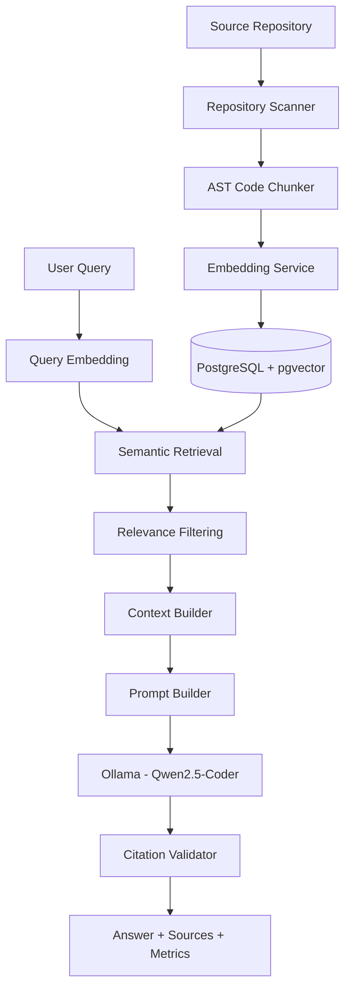

# CodePilot — AI-Native Coding Assistant

CodePilot is a local-first, repository-aware AI coding assistant designed to explore the architecture and engineering principles behind modern AI-native IDEs.

The project combines semantic code search, Retrieval-Augmented Generation (RAG), local LLM inference, and structured source citations to provide context-aware assistance directly from a developer's codebase.

Built incrementally using open-source tools and local infrastructure, without relying on paid LLM APIs.

## Current Features

- Python repository scanning and AST-based code chunking.
- SHA-256 content hashing and deterministic chunk identifiers.
- Local embedding generation using Sentence Transformers.
- Persistent vector storage using PostgreSQL and pgvector.
- HNSW indexing and cosine similarity search.
- Repository-aware Retrieval-Augmented Generation.
- Local LLM inference using Ollama and Qwen2.5-Coder.
- Similarity-based context filtering.
- Overlapping code chunk deduplication.
- Estimated context token budgeting.
- Grounded prompt construction.
- Structured source metadata and citation validation.
- Interactive and single-question CLI modes.
- Retrieval, augmentation, generation, and validation latency instrumentation.
- Automated unit testing and mocked failure simulation.

## System Architecture



## Technology Stack

| Component | Technology |
|---|---|
| Programming language | Python |
| Code parsing | Python AST |
| Embedding model | all-MiniLM-L6-v2 |
| Embedding dimensions | 384 |
| Database | PostgreSQL 16 |
| Vector search | pgvector |
| Vector index | HNSW |
| Similarity metric | Cosine similarity |
| LLM runtime | Ollama |
| Language model | Qwen2.5-Coder 3B |
| HTTP client | HTTPX |
| Infrastructure | Docker Compose |
| Testing | Pytest, unittest.mock |
| Version control | Git and GitHub |

## Project Structure

```text
CodePilot/
├── backend/
│   ├── app/
│   │   ├── indexing/
│   │   │   ├── scanner.py
│   │   │   ├── chunker.py
│   │   │   ├── indexer.py
│   │   │   └── models.py
│   │   ├── embeddings/
│   │   │   ├── service.py
│   │   │   └── similarity.py
│   │   ├── retrieval/
│   │   │   ├── models.py
│   │   │   ├── search.py
│   │   │   └── persistent_search.py
│   │   ├── storage/
│   │   │   ├── database.py
│   │   │   ├── vector_repository.py
│   │   │   └── schema.sql
│   │   ├── llm/
│   │   │   └── service.py
│   │   └── rag/
│   │       ├── context_builder.py
│   │       ├── context_models.py
│   │       ├── citation_validator.py
│   │       ├── prompts.py
│   │       ├── engine.py
│   │       └── models.py
│   ├── tests/
│   └── requirements.txt
├── cli.py
├── docker-compose.yml
├── .env.example
├── .gitignore
└── README.md
```

## Getting Started

### Prerequisites

- Python 3.10+
- Git
- Docker Desktop
- Ollama

A dedicated GPU is optional but recommended for faster local inference.

### 1. Clone the repository

```bash
git clone https://github.com/akashkuteX/CodePilot.git
cd CodePilot
```

### 2. Create a virtual environment

Windows PowerShell:

```powershell
python -m venv .venv
.\.venv\Scripts\Activate.ps1
```

### 3. Install dependencies

```bash
pip install -r backend/requirements.txt
pip install pytest
```

### 4. Configure environment variables

```powershell
Copy-Item .env.example .env
```

Configure the following variables in `.env`:

```env
POSTGRES_USER=codepilot
POSTGRES_PASSWORD=your_local_password
POSTGRES_DB=codepilot
POSTGRES_HOST=127.0.0.1
POSTGRES_PORT=5433

OLLAMA_BASE_URL=http://localhost:11434
OLLAMA_MODEL=qwen2.5-coder:3b
OLLAMA_CONTEXT_WINDOW=4096
OLLAMA_TIMEOUT=120
```

Never commit the `.env` file or database credentials.

### 5. Start PostgreSQL

```bash
docker compose up -d
```

Initialize the database schema using PowerShell:

```powershell
Get-Content backend/app/storage/schema.sql -Raw | docker exec -i codepilot-postgres psql -v ON_ERROR_STOP=1 -U codepilot -d codepilot
```

### 6. Download the local language model

```bash
ollama pull qwen2.5-coder:3b
```

Ensure the Ollama service is running before using the chat functionality.

The embedding model is downloaded automatically when initialized for the first time.

## CLI Usage

### Index a repository

```bash
python cli.py index --path .
```

### Count stored chunks

```bash
python cli.py count
```

### Perform semantic code search

```bash
python cli.py search --query "How are embeddings generated?" --top-k 5
```

### Ask a repository-aware question

```bash
python cli.py chat --query "How does CodePilot validate citations?"
```

### Start an interactive session

```bash
python cli.py chat
```

Type `exit` or `quit` to end the session.

### Enable performance metrics

```bash
python cli.py chat --query "How does semantic search work?" --metrics
```

## RAG Pipeline

CodePilot processes repository-aware questions through the following stages:

1. Generate a query embedding.
2. Retrieve semantically similar code chunks from pgvector.
3. Filter candidates using a similarity threshold.
4. Remove overlapping source chunks.
5. Construct context within an estimated token budget.
6. Build a grounded prompt containing source references.
7. Generate an answer using the local language model.
8. Validate referenced source identifiers.
9. Return the answer, source metadata, and performance metrics.

If no usable context is available, the pipeline returns an insufficient-context response without invoking the language model.

## Current Configuration

| Parameter | Default |
|---|---:|
| Embedding dimensions | 384 |
| Embedding batch size | 32 |
| Retrieval Top-K | 5 |
| Minimum similarity | 0.35 |
| Model context window | 4096 tokens |
| Retrieved context budget | 2800 estimated tokens |
| Maximum generated tokens | 512 |
| Generation temperature | 0.2 |
| HTTP timeout | 120 seconds |

These parameters are initial engineering choices and will be refined through evaluation and benchmarking.

## Preliminary Performance Benchmark

Development hardware:

- NVIDIA GTX 1650 Ti — 4 GB VRAM
- 16 GB system RAM
- Windows 11
- Qwen2.5-Coder 3B running through Ollama

### Local inference benchmark

| Metric | Observed result |
|---|---:|
| Generation throughput | 58.24 tokens/sec |
| Prompt evaluation throughput | 64.71 tokens/sec |
| Model GPU allocation | 100% |
| Loaded model size | Approximately 2.2 GB |

### End-to-end RAG benchmark

| Stage | Observed latency |
|---|---:|
| Retrieval | 1.068 s |
| Context augmentation | < 0.001 s |
| Generation | 10.162 s |
| Total | 11.231 s |

Generation accounted for approximately 90.5% of the measured request latency, making inference the primary optimization opportunity in this benchmark.

These are preliminary single-run development measurements, not production latency guarantees or statistically representative benchmarks.

## Testing

Run the complete test suite:

```bash
python -m pytest backend/tests -v
```

### Current Test Coverage

| Component | Passing tests |
|---|---:|
| Repository indexing | 13 |
| Embeddings and similarity | 11 |
| Context builder | 7 |
| Prompt construction | 3 |
| Citation validation | 5 |
| RAG orchestration | 6 |
| LLM service | 5 |
| Total | 50 |

The RAG and LLM service tests use mocked external dependencies to validate application behavior without requiring live inference or database connections.

The embedding tests use the actual embedding model.

Passing unit tests establish functional reliability but do not guarantee generated answer accuracy.

## Engineering Principles

- Local-first AI infrastructure.
- Separation of concerns.
- Modular and testable components.
- Resource reuse.
- Deterministic application-level validation.
- Evidence-grounded generation.
- Graceful handling of inference failures.
- Performance instrumentation.
- Incremental development.

## Current Limitations

- Repository parsing currently supports Python source files.
- Incremental indexing and stale chunk removal are not implemented.
- Token budgeting uses an approximate estimator.
- Citation validation checks source identifiers, not semantic faithfulness.
- Interactive chat does not maintain conversational history.
- Retrieved source code may contain prompt injection attempts; prompt instructions provide limited mitigation.
- Source code is stored in the local PostgreSQL database.
- Repository-level isolation and production authentication are not implemented.
- Formal RAG quality evaluation and load testing are pending.

## Development Roadmap

- [x] Day 1 — Repository scanning and AST-based code indexing
- [x] Day 2 — Embeddings and persistent vector search
- [x] Day 3 — Retrieval-Augmented Generation and local LLM integration
- [ ] Day 4 — Incremental indexing and Merkle trees
- [ ] Day 5 — FastAPI backend
- [ ] Day 6 — VS Code extension
- [ ] Day 7 — Fill-in-the-middle code completion
- [ ] Day 8 — Agent architecture and tool calling
- [ ] Day 9 — Multi-file editing and approval workflows
- [ ] Day 10 — Redis and caching
- [ ] Day 11 — Asynchronous workers
- [ ] Day 12 — Security and reliability
- [ ] Day 13 — RAG evaluation and performance benchmarking
- [ ] Day 14 — Documentation and final demonstration

## Project Inspiration

Inspired by *System Design for the LLM Era: Patterns and Principles for Production-Grade AI Architecture* by Sampriti Mitra.

CodePilot is an independent hands-on implementation exploring AI-native IDE architecture and production-oriented AI engineering principles.

## Author

**Akash Kute**

- Portfolio: https://www.akashkute.com
- GitHub: https://github.com/akashkuteX
- LinkedIn: https://www.linkedin.com/in/akash-kute

---

CodePilot is under active development.